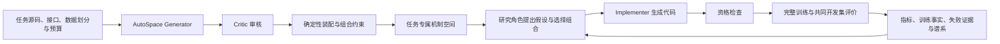

# RecClaw：当前源码与架构（2026-09-21 阶段快照）

RecClaw 是面向推荐算法研究的 AI scientist / agent harness：根据任务源码与约束生成机制搜索空间，将研究假设实现为候选代码，通过真实训练与评价获取反馈，再开展下一轮研究。

**当前材料请从 [`current/`](current/README.md) 阅读。** 这是课程介绍、后续讨论与自行制作 PPT 的源码快照，不是最终封版；主线实验继续独立推进。

- [架构与思想（中文）](current/docs/ARCHITECTURE.zh-CN.md)
- [源码导读与调用关系](current/docs/CODE_MAP.zh-CN.md)
- [研究闭环示例与答辩表述](current/docs/RESEARCH_LOOP.zh-CN.md)
- [来源、部署版本及验证边界](current/docs/SNAPSHOT_SCOPE.md)



空间生成与迭代研究是相互衔接的两部分。当前图入口保留科研反馈，但冻结显式搜索策略更新，不能把它描述成已证明有效的在线元学习。

以下内容和顶层 `scripts/`、`configs/` 等属于历史工作区，保留以避免覆盖旧工作；不是本快照的当前部署入口。

## 历史 README

RecClaw is a recommender-system research agent workspace built around RecBole.
It is used to propose, validate, implement, run, and reflect on candidate
recommendation algorithms under a fixed evaluation protocol.

The current runtime focuses on controlled BPR/LightGCN action-space exploration
with local extension code under `recclaw_ext/`.

## Main Pieces

- `configs/action_space.yaml`: runtime boundary for what the agent may change.
- `configs/candidate_registry.yaml`: runnable candidate catalog.
- `scripts/agent.py`: Observe -> Plan -> Propose -> Validate -> Run -> Reflect loop.
- `scripts/run_candidate.py`: isolated candidate execution.
- `scripts/build_experience_summary.py`: reflection memory and search steering.
- `recclaw_ext/`: local model/loss/sampler extensions.
- `recclaw_program.md`: operating manual for the agent and experiments.

## Quick Checks

```bash
python3 scripts/analysis/lint_recclaw_space.py
python3 -m unittest discover -s tests
```

## Pilot Entry

Use an isolated output directory for each run:

```bash
python3 scripts/run_reflection_pilot.py \
  --rounds 50 \
  --proposal-source llm \
  --search-intensity algorithm_first \
  --gpu-id 0
```

Keep `RecClaw_LabLog` out of runtime inputs. Use it only for human-facing
analysis, plots, and reports.
