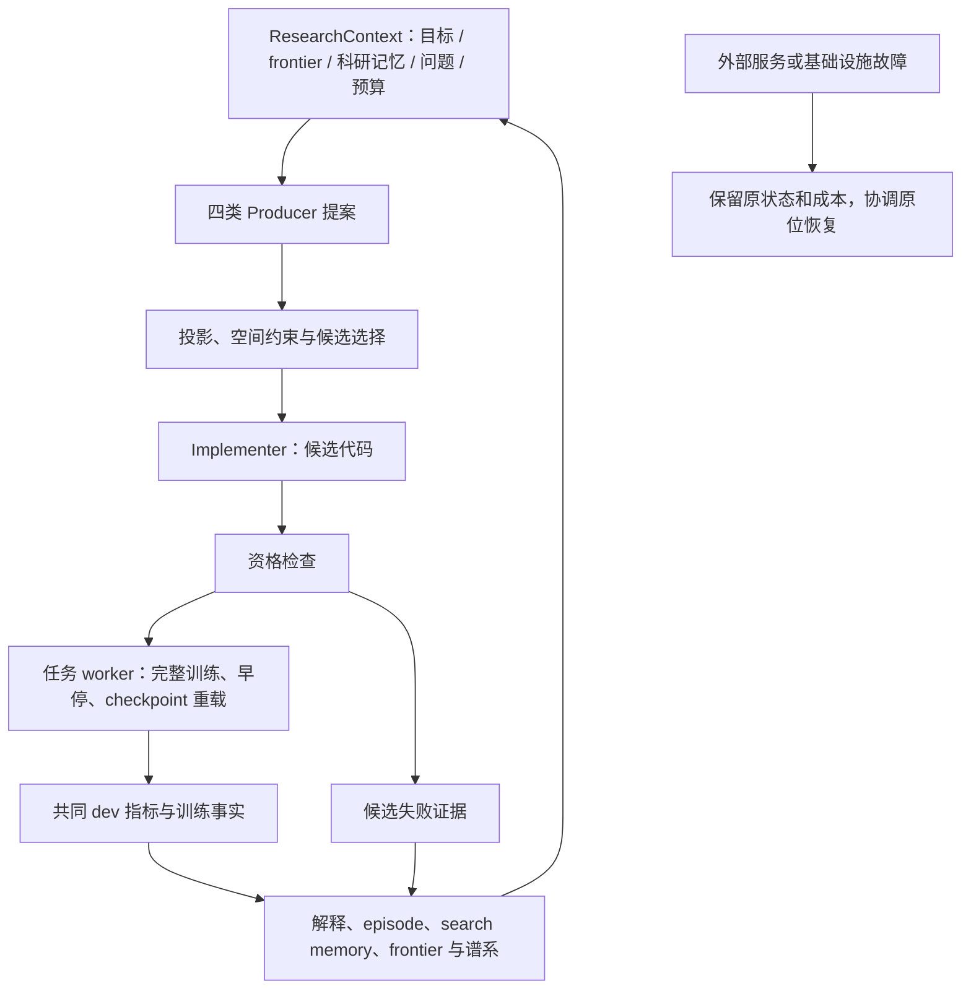

# RecClaw 当前架构与思想

## 一句话定位

RecClaw 是面向推荐算法研究的 AI scientist / agent harness：给定推荐任务和允许修改的算法接口，生成任务相关的机制空间，提出、实现并实验检验假设，把真实结果反馈给后续研究。它研究和改进推荐算法，本身不是固定的推荐模型。

统一的是研究闭环，而不是要求所有任务使用同一模型、同一组机制或同一训练脚本。

## 四个协作层次

| 层次 | 实际职责 | 主要产物 |
|---|---|---|
| 外部任务环境 | 提供 seed recommender 源码、数据与划分、任务事实、研究背景、可修改接口和预算 | 根模型、任务合同、共享事实、训练/评价绑定 |
| AutoSpace | 根据源码与合同生成机制原语，审核后装配空间 | 原语集合、组合语法、兼容约束、可执行接口、质量报告 |
| Research Line | 提出假设、选择/组合机制、实现候选、消费实验反馈 | 研究提案、机制绑定、候选代码、研究状态与谱系 |
| 执行与证据层 | 资格检查、受保护完整训练、共同开发集评价、成本记录、结果回接 | 指标、训练曲线、失败类型、配置与来源身份 |

`SearchSpaceAdapter` 连接通用研究层与具体模型接口。图任务的 `GraphSearchAdapter` 注入任务事实、原始模型、AutoSpace 与资格执行器。研究层不能任意修改数据划分、评价器或预算；任务环境也不能把旧赢家或实验私有空间伪装成通用核心。

## AutoSpace：先构造可研究的空间

输入首先是**任务源码和合同**。源码提供现有方法、调用位置与计算路径；合同给出可以改变的文件、接口和数据角色，以及必须保持的训练与评价条件。

1. **Generator / Genesis** 规划机制族，生成具有科学含义的原语。不仅给出名字，还规定作用位置、实现要求、张量/梯度/评分效应、训练或推断阶段、不变量和组合关系。
2. **Critic** 检查覆盖、冗余、运行可达性、效应强度和可组合性。保留或剔除原提案并记录原因；当前图版本不补写新机制或重新抽样来凑数量。
3. **确定性 assembler** 校验 schema、源码锚点和合同，装配 registry、grammar、capability policy，计算合法组合并产出质量报告。
4. **NormalizedSearchSpace** 将产物交给 Research Line。概念合理性还需后续实现与训练检验，审核 PASS 不是性能提升。

当前图任务四类是 `representation`、`scoring`、`objective`、`architecture`，依据真实模型/损失 ABI 组织。它们是机制作用维度，不是四个预置算法。采样、优化器和训练循环由图 worker 持有，不能凭轴名扩大修改权限。

MoRec 六轴版本还包含允许接口内的训练更新与训练采样，有不同的文件与区域约束。**四轴与六轴体现任务接口差异，并非所有环境共用一套固定轴。** `1.6.1` 是继承的内容/schema 标识；准确身份还要结合 task variant 与源哈希。

图入口使用 `SELECT`（一个原语）或 `COMPOSE`（两至三个原语），每次从原始 root 构造完整候选。历史有效机制若要保留，必须显式再次选入；谱系改进不意味着隐式继承父代全部代码。核心库保留更广接口，但当前图入口禁止 custom synthesis/replacement。

## Research Line：把机制假设变成实验

源码定义四个研究 Producer。它们是共享研究状态的职责分工，不应画成四个必然同时独立训练的系统。

| 精确角色名 | 答辩解释 |
|---|---|
| `mechanism_composer` | 提出机制组合及预期作用 |
| `lineage_refiner` | 根据已有候选及反馈提出后续改进 |
| `falsification_designer` | 提出可区分解释、检验假设的问题 |
| `frontier_architect` | 面向当前能力缺口提出研究方向 |

提案经投影、约束解析与选择成为研究规格；Implementer 生成允许范围内的代码。资格检查先检验接口、实现合法性和可执行性，然后受保护 worker 完成真实训练与共同开发集评价。角色是职责和接口，不保证每条提案执行，也不保证有限预算内完成严格因果确认。

## 反馈如何回到下一轮

图任务 `GraphROExecution` 将共同 evaluator 的结果转换为核心结果契约；`completed_worker_feedback` 带回 epochs、best epoch、停止原因、训练曲线与配置。`interpreter.py` 组织研究反馈与后继 context，`campaign.py` 保存 round、episode、记忆及后续状态。下一轮 Provider 读取 `ResearchContext`，其中含 `frontier`、`scientific_memory`、`unresolved_questions` 和预算。

反馈具体回答：机制是否可实现、代码实际改变了什么、训练如何、效果如何、还有什么问题。缺失事实保持缺失，不填零；候选失败与外部故障分开，后者不能成为算法零分或负面科学证据。

**当前图入口显式安装 `FrozenSearchPolicy`。** 它保留科研上下文和反馈，冻结显式 acquisition/ranking policy 的适应性更新。因此可以说明跨轮实验反馈与谱系，不能宣称此部署已启用或证明“长期记忆带来提升”“在线元学习不断优化策略”。库里存在接口、当前配置实际使用、效果成立，是三件不同的事。

## 当前形态与证据边界

当前是 Python 研究系统，由任务入口、共享核心、源码/schema/prompt 资源、外部 Provider 与受保护 worker 组成，不是面向最终用户的一体化网页产品。

已有适配与研究工作覆盖 SASRec、BERT4Rec、MoRec、MultiVAE；NGCF 与 LightGCN++ 是两个独立图环境。普通 LightGCN 是历史/静态参照，不与 LightGCN++ 混写。各运行按自己的源码、空间、seed、数据与预算冻结，不能宣称已同时升级到本快照。

本次直接核验发布源码身份、MoRec 版本差异与最小离线检查，不发布新成绩表、不重新核算正式比较，也不承诺 RO 胜过 RH。空间审核通过、候选跑通、单次开发改善、跨重复公平比较分别需要不同证据。
